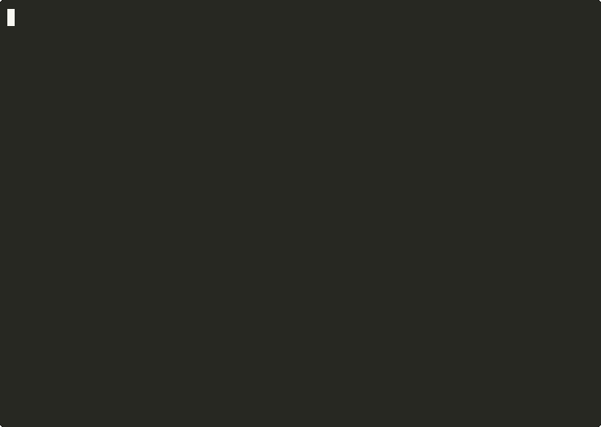
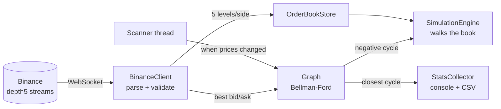

# Crypto Arbitrage Engine

A real-time triangular-arbitrage detector for the Binance spot market, in C++20. It streams live order books over WebSocket, models the market as a weighted directed graph, finds profitable currency cycles with Bellman-Ford, and then checks whether each one survives real order-book depth.

[](https://github.com/AsafCo2211/crypto-arbitrage-engine/actions/workflows/ci.yml)


> **Detection and simulation only — it never places orders.** At retail latency these opportunities are usually gone before you could act; the point of the project is the market model, the graph algorithm, and the concurrency around a live feed.

<p align="center">
  
</p>

A real 65-second run against live Binance data (waits between summaries shortened). About 1,000 order-book updates, 477 Bellman-Ford scans, **no profitable cycle** — and the closest one, `USDT → LINK → BTC → USDT`, finished **0.27% below break-even after fees**. See [When there's nothing to find](#when-theres-nothing-to-find).

---

## The idea in one example

Start with 1,000 USDT. Buy ETH, use the ETH to buy BTC, sell the BTC back to USDT. If the three exchange rates are slightly inconsistent, you end the loop with more than 1,000 USDT — after paying a 0.1% fee on every leg.

Finding such a loop is a graph problem:

- Every **currency** is a node.
- Every **trading pair** gives two edges — `USDT → ETH` at `1 / ask` (buying) and `ETH → USDT` at `bid` (selling).
- Each edge's weight is **`−log(rate × (1 − fee))`**.

Logs turn the product of rates along a path into a sum, and the minus sign flips "product greater than 1" into "sum less than 0". So **a profitable loop is exactly a negative-weight cycle** — which Bellman-Ford detects in O(V·E).

## From detection to "would it actually work?"

The theoretical profit uses the best price on each book, as if unlimited size were available there. Real orders eat through several price levels. The engine subscribes to 5 levels per side (`@depth5`) and, for each opportunity, **walks the real book** at several trade sizes:

```
Buying $500 of ETH with ask levels  3200.00 × 0.10,  3200.40 × 0.25, ...
  level 1 fills 0.10 ETH, level 2 fills the rest at a worse price
  → average fill above the best ask → net profit shrinks as size grows
```

Each size is reported as viable or not, and flagged when the 5 visible levels can't fill it at all.

## When there's nothing to find

On a liquid exchange, a three-leg loop costs about 0.3% in fees alone, so most of the time no profitable cycle exists — and "0 opportunities" says nothing about how close the market came.

So on every scan the engine also evaluates **every three-leg loop through the source currency** (`Graph::bestTriangle`, ~1,600 edge pairs for the default market) and keeps the best net result, profitable or not. The 30-second summary reports it. From the recorded run above:

```
[STATS] Opportunities found: 0
[STATS] Closest cycle:       -0.2666% net  (USDT->LINK->BTC->USDT)
```

Three legs at 0.1% cost 0.2997% in fees, so that loop was actually **+0.03% before fees** — a real price inconsistency, just smaller than the cost of trading it. That gap is a direct measurement of how efficient the market is.

## Guarding against false signals

Live market data is noisy, and a single bad quote can manufacture a fake cycle.

| Guard | What it prevents |
|---|---|
| **Quote sanity** | Non-positive prices (would break the logarithm) and crossed books where bid ≥ ask (a stale or out-of-order message that looks like free money) |
| **Freshness** | Edges older than `maxQuoteAgeMs` are ignored, so a stale price can't pair with a fresh one |
| **Profit threshold** | Only cycles above `minProfitPercent` *after fees* are reported |
| **Cooldown** | The same route isn't re-reported within `cooldownSeconds` |

---

## Architecture



### Threads and shared state

| Thread | Role |
|---|---|
| WebSocket (IXWebSocket) | Parses each message, updates the graph and the order book |
| Scanner | When prices have changed, runs Bellman-Ford — at most once per `scanIntervalMs` |
| Summary | Prints windowed and total stats every 30 seconds |
| Main | Waits for Ctrl+C / SIGTERM or the `--duration` deadline, then shuts down in order |

- The **graph** is guarded by a single mutex. An `std::atomic<bool>` "dirty" flag tells the scanner something changed without taking the lock on every tick, and lets it skip scans when nothing did.
- The **order book store** uses `std::shared_mutex`: the simulation reads several books concurrently under shared locks, while each WebSocket update takes an exclusive lock.
- **Shutdown** closes the WebSocket first, so no callback can touch the graph after the worker threads exit.

---

## Build and run

**Requirements:** CMake 3.16+, a C++20 compiler, OpenSSL, nlohmann/json. IXWebSocket is a git submodule; GoogleTest is fetched by CMake.

```bash
# macOS
brew install cmake openssl@3 nlohmann-json
# Ubuntu / Debian
sudo apt-get install cmake build-essential libssl-dev nlohmann-json3-dev
```

```bash
git clone --recurse-submodules https://github.com/AsafCo2211/crypto-arbitrage-engine.git
cd crypto-arbitrage-engine
cmake -B build -DCMAKE_BUILD_TYPE=Release
cmake --build build --parallel

./build/ArbitrageEngine                 # run until Ctrl+C
./build/ArbitrageEngine --duration 120  # stop after two minutes
```

Detected opportunities are also appended to `opportunities.csv`.

> Binance blocks connections from some regions (including the US). If the engine connects but receives no ticks, that is the likely cause.

## Configuration

`config/config.json` is validated at startup.

| Key | Default | Meaning |
|---|---|---|
| `fee` | `0.001` | Taker fee per leg (0.1%) |
| `minProfitPercent` | `0.1` | Minimum net profit to report, in % |
| `maxQuoteAgeMs` | `3000` | Ignore quotes older than this |
| `cooldownSeconds` | `10` | Don't re-report the same route within this window |
| `scanIntervalMs` | `100` | Minimum time between Bellman-Ford scans |
| `sourceCurrency` | `"USDT"` | Start node for Bellman-Ford |
| `simulationNotionals` | `[100, 500, 1000]` | Trade sizes (in USD) to simulate against the book |
| `symbols` | 20 pairs | Each entry: Binance stream name, base and quote currency |

The default market is ten coins quoted in both USDT and BTC, which gives the graph many three-leg cycles through USDT and BTC.

## Tests

38 GoogleTest cases, run on every push by GitHub Actions.

```bash
cmake -B build -DBUILD_TESTS=ON
cmake --build build --parallel
ctest --test-dir build --output-on-failure
```

| File | Covers |
|---|---|
| `test_graph.cpp` | Detects a known profitable cycle; no false positive on consistent rates; fees and threshold filter correctly; stale quotes ignored. Closest-cycle search: exact fee cost on a fair market, picks the better loop direction, summary output |
| `test_simulation.cpp` | Order-book lookup by side; slippage on deep vs. shallow books; insufficient-liquidity flag; quote sanity (crossed and locked books) |
| `test_config.cpp` | Loading, validation, and every error case |

## Project layout

```
include/
  BinanceClient.hpp     WebSocket feed, message parsing, quote validation
  Graph.hpp             market graph, Bellman-Ford, closest-cycle search
  OrderBook.hpp         thread-safe 5-level order books
  SimulationEngine.hpp  walks the book to estimate fill price and net profit
  StatsCollector.hpp    windowed metrics + CSV export
  Config.hpp            JSON config loading and validation
src/main.cpp            wiring, threads, shutdown
tests/                  GoogleTest suites
external/IXWebSocket    submodule
```

## Limitations

- **Latency.** Data arrives tens of milliseconds late over the public internet; firms that capture these spreads co-locate next to the exchange.
- **Five levels of depth.** Large sizes can exhaust the visible book; the simulation flags this rather than guessing.
- **One exchange.** Cross-exchange arbitrage (e.g. Binance vs. Kraken) isn't modelled.
- **One cycle per scan, from one source.** Bellman-Ford from `USDT` reports the first negative cycle it finds; cycles unreachable from the source aren't searched.
